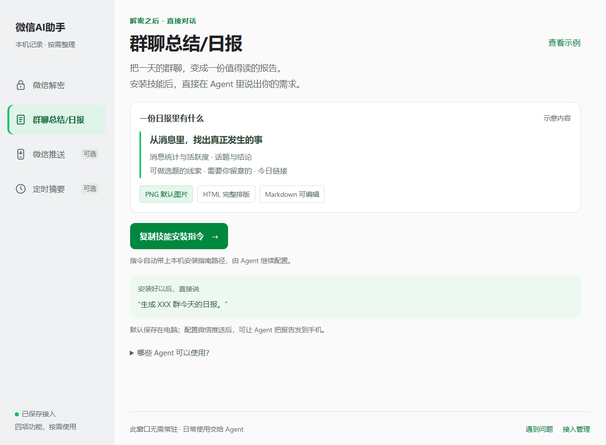
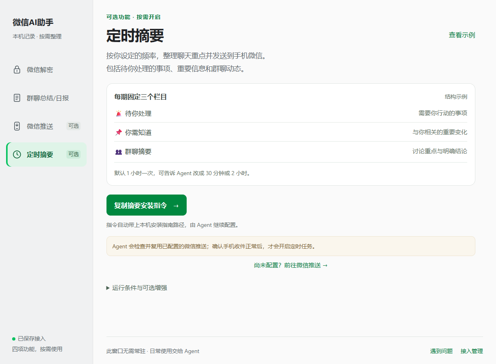

# 微信AI助手

让群聊变成值得读的报告，让重要消息及时到达。

**微信记录解密 · 群聊总结 / 日报 · 微信推送 · 定时摘要**

[下载与版本](docs/downloads.md) · [Windows 安装](docs/windows.md) · [常见问题](docs/faq.md) · [隐私说明](docs/privacy.md)

微信AI助手将电脑上已同步的微信记录，交给你常用的 Agent 按需整理。配置完成后，日常使用直接在 Agent 对话里继续。

> 本仓库用于产品介绍、部署包下载、使用说明和问题反馈，不提供项目源码。Windows 和 Mac 分别维护版本，版本号无需一致。

## 下载

| 平台 | 本次准备发布的版本 | 文件格式 | 安装说明 |
| --- | --- | --- | --- |
| Windows | v1.9 · 2026-10-24 | ZIP，约 275 MiB | [查看安装步骤](docs/windows.md) |
| Mac | v2.4.1 · 2026-10-23 | DMG，约 236 MiB | 打开镜像后查看随包说明；系统与芯片要求待核实 |

下载附件将在对应的 GitHub Release 中提供；当前页面为发布准备稿，尚未开放安装包下载。详见[下载与版本](docs/downloads.md)。

## 能做什么

下面的界面与具体流程以 Windows v1.9 为准。Mac 的界面和功能范围以其随包说明为准。

| 功能 | 用途 | 使用方式 |
| --- | --- | --- |
| 微信解密 | 接入本人电脑上已同步的微信记录 | 在桌面程序中完成首次配置 |
| 群聊总结 / 日报 | 把指定群、指定时间的聊天整理成报告 | 安装技能后，直接跟 Agent 对话 |
| 微信推送 | 将报告图片或指定附件发送到本人手机微信 | 按需绑定，发送时明确提出要求 |
| 定时摘要 | 按设定频率整理待处理事项、重要信息和群聊动态 | 可选开启，可调整频率 |

### 直接说出需求

> 生成“XXX群”今天的日报。

> 总结“XXX群”最近三天的讨论，告诉我有哪些结论。

> 分别生成“群A”和“群B”今天的日报，保存在电脑。

日报默认输出 PNG 图片，同时保留 HTML 和 Markdown。可包含消息统计、活跃度、话题与结论、选题线索、需要留意的事项和链接；实际内容取决于当天消息，不为凑版面编造信息。

配置微信推送后，还可以说：

> 把这份群日报图片发到我的手机微信。

报告默认保存在电脑；绑定推送不会自动发送每一份报告。

## 看看效果

**Windows：群聊总结 / 日报**

展开查看日报长图示例

示例用于展示排版，不代表真实群聊事实。图片较长，点击图片可单独打开阅读。

**Windows：定时摘要**

## Windows 三步开始

1. 下载并完整解压 Windows 部署包，打开根目录的 **微信AI助手.exe**。
2. 按提示完成微信解密；需要时由本人重新登录电脑微信。
3. 在“群聊总结/日报”复制技能安装指令，粘贴给支持本机文件访问和技能安装的 Agent。

以后直接在 Agent 中提出需求，这个面板可以关闭。微信推送与定时摘要按需配置，不是生成本地日报的必需步骤。

Windows 包已带 Python、核心依赖和 WebView2 离线运行库。PNG 输出需要电脑已有可用的 Edge 或 Chrome。完整步骤见 [Windows 安装说明](docs/windows.md)。

## 本地读取与模型处理

微信记录在本机读取。使用云端 Agent 整理群聊时，你指定范围的聊天素材会交给该 Agent 处理，不能据此理解为全程离线。仅安装技能不会读取聊天正文。

Windows 定时摘要当前默认使用本地规则；自动接入云端模型和本地 Ollama 尚未完成。详见[隐私与数据处理](docs/privacy.md)。

## 反馈问题

可以在仓库的 Issues 中提交问题，说明平台、版本、操作步骤、期望结果与实际结果。Windows 程序内的“遇到问题”也能生成交给 Agent 的排查请求。

公开反馈前检查截图和附件，移除聊天正文、联系人、账号标识、二维码、密钥和令牌。不要上传整个微信数据目录。

本项目不是腾讯或微信官方产品。第三方组件的许可声明保留在部署包内，具体发布状态与已知限制见各平台发行说明。
